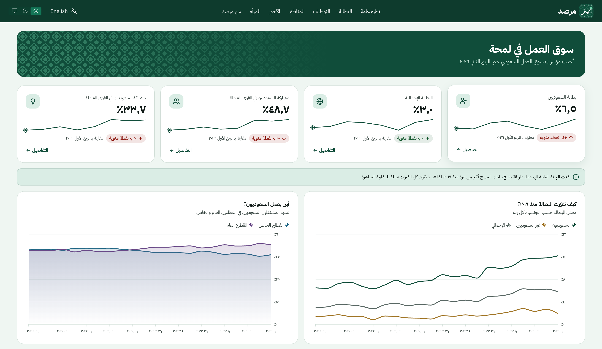
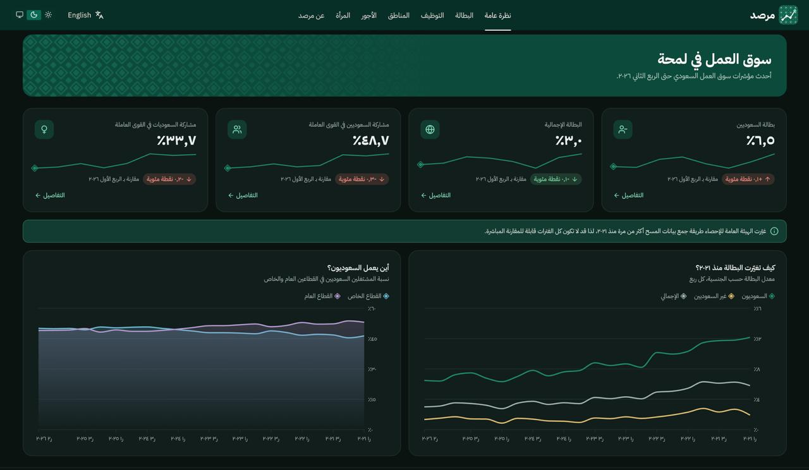
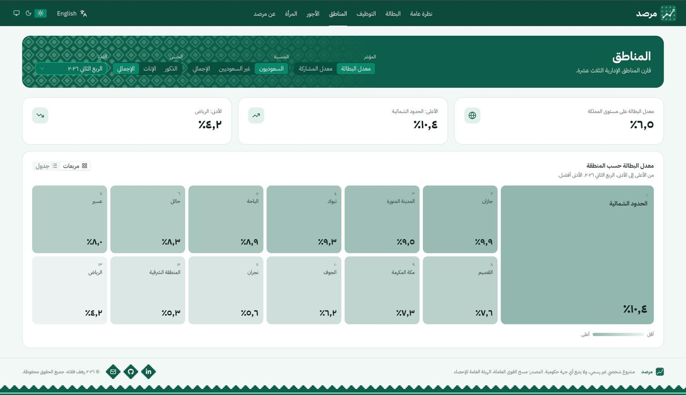
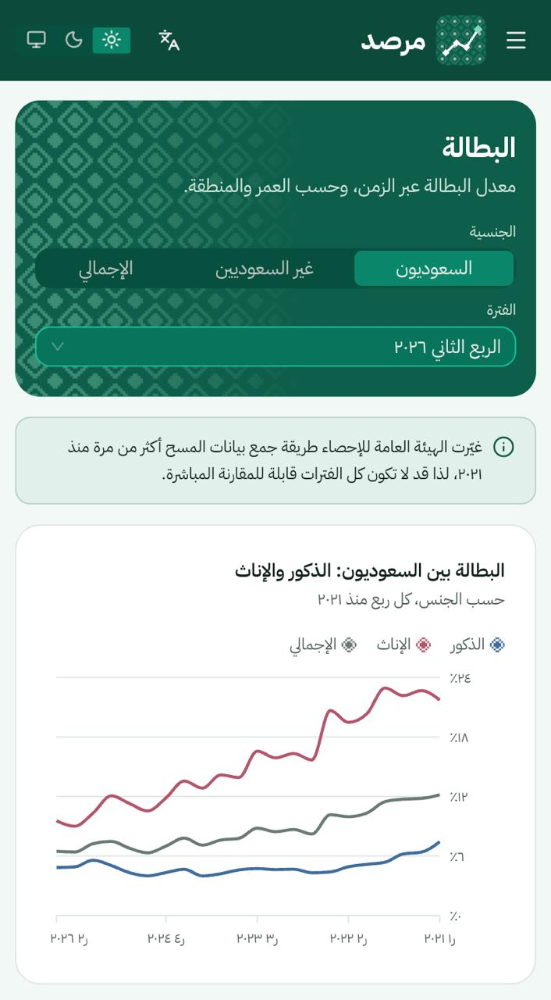
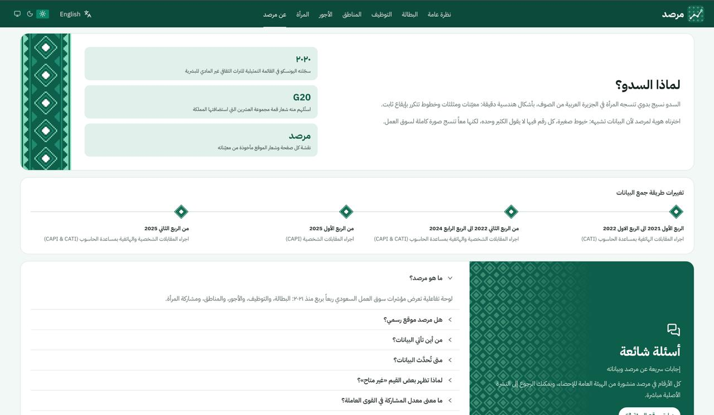
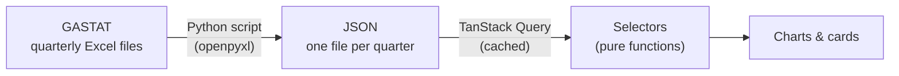

<div align="center">


# مَرْصَد · Marsad

**The Saudi labor market, quarter by quarter, in numbers anyone can read.**

لوحة تفاعلية لمؤشرات سوق العمل السعودي، مبنية على البيانات الرسمية للهيئة العامة للإحصاء

<br />


</div>

<br />

<p align="center">
  
  
</p>

---

## ✨ What's inside

| | |
|---|---|
| 🌍 **Arabic first** | Fully right-to-left, with English one click away. Even the charts flip correctly. |
| 🌗 **Light, dark & system** | Every color comes from one token file, so both themes stay in sync. |
| 📊 **A chart for each question** | Trends, rankings, a donut for shares, a 100% bar for ordered levels, a dumbbell for the gender pay gap, heat tiles for the regions. |
| 🧵 **An identity woven from Al Sadu** | The Bedouin weaving listed by UNESCO, drawn stitch by stitch in SVG. |
| ♿ **Accessible** | WCAG-checked contrast, screen-reader labels, keyboard focus, reduced-motion support. |
| 📱 **Responsive** | Designed for phone, tablet and desktop, not just squeezed onto them. |

## 📄 The pages

<p align="center">
  
  
</p>

**Overview** · **Unemployment** · **Employment** · **Regions** · **Wages** · **Women in the workforce** · **About**

Every filter lives in the URL, so any view can be shared as a link.

## 🧵 Why Al Sadu?



Al Sadu is the Bedouin weaving of the Arabian Peninsula, made by women in precise geometric
patterns, and inscribed by UNESCO as intangible cultural heritage in 2020.

Data works the same way: small threads, each number saying little on its own, that together
weave a full picture of the labor market.

Every Sadu motif in Marsad (the page pattern, the woven band, the eyes on the charts, the
loader, even the logo) is generated from one small module, `saduShapes.ts`, that draws
shapes stitch by stitch, the way they're woven.

<br clear="right" />

## 🔄 From GASTAT to the screen



The Excel layout changes from year to year, so the converter finds each table by its title
rather than its position, and checks the numbers as it goes.

## 🛠️ Technical decisions worth a look

- **Charts in Arabic.** SVG text-anchor flips under a right-to-left page, which pushes labels
  into the bars. The chart area is drawn left-to-right and mirrored by hand instead.
- **One source of truth for design.** `tokens.ts` feeds both Ant Design's theme and CSS
  variables, so a color or spacing change happens in one place.
- **Missing isn't zero.** Values GASTAT doesn't publish are shown as "not available" and
  leave gaps in lines, never fake drops to zero.
- **Feature-based structure.** Each page owns its folder; anything shared lives in `shared/`.

<details>
<summary><b>📁 Project structure</b></summary>

```
src/
  app/        layout, routing, navigation
  features/   one folder per page, plus labor-data (types, hooks, selectors)
  shared/     components, charts, Sadu motifs, i18n, theme tokens, helpers
public/data/  the survey data as JSON, one file per quarter
scripts/      the Python converter from GASTAT Excel to JSON
```

</details>

## 🚀 Run it locally

```bash
npm install
npm run dev
```

<details>
<summary><b>🔁 Updating the data</b></summary>

Download the quarterly Excel files from GASTAT into `raw-data/`, then:

```bash
python3 -m venv .venv
.venv/bin/pip install openpyxl
.venv/bin/python scripts/convert_labor_data.py raw-data/ public/data/
```

</details>

## 📚 Data source

General Authority for Statistics (GASTAT), Labour Force Survey, Labor Market Statistics bulletins.

---

<div align="center">

Made with care by **Rahaf** · An unofficial personal project, not affiliated with any government entity.

</div>